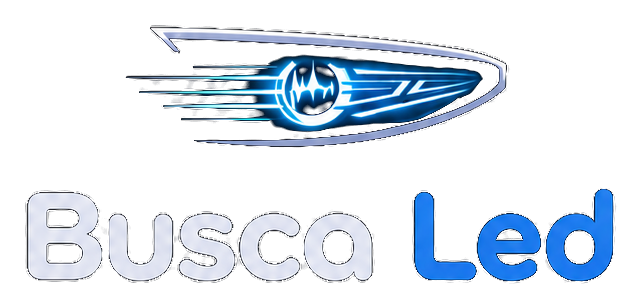

# BuscaLED

<p align="center">
  
</p>

[](https://github.com/Vytor-Oliveira/BuscaLed/actions/workflows/ci.yml)
[](https://sonarcloud.io/summary/new_code?id=Vytor-Oliveira_BuscaLed)
[](https://sonarcloud.io/summary/new_code?id=Vytor-Oliveira_BuscaLed)

Motor de Compatibilidade e Orquestração de Pedidos para Iluminação Automotiva LED.

> Garagem Virtual · Controle de Estoque · Edição de Ticket · Acompanhamento de Pedidos

> Projeto de Portfólio — Engenharia de Software, Católica SC.
> RFC completa: a ser publicada em `/docs/RFC.pdf` assim que disponível.

## Sobre o projeto

O mercado de iluminação automotiva LED no Brasil movimenta um volume crescente de
vendas, especialmente no segmento de retrofit. Representantes comerciais — como o
parceiro deste projeto, a marca **Shocklight** — respondem manualmente no WhatsApp
qual LED serve em cada veículo, consultando tabelas em PDF que ficam desatualizadas
e não escalam.

O **BuscaLED** resolve isso cruzando os dados de um veículo (por placa ou manualmente)
com a matriz de compatibilidade de LEDs automotivos da Shocklight, retornando todos os
modelos compatíveis por posição de farol (farol baixo, alto, neblina, lanterna), cada uma
podendo ter múltiplos modelos disponíveis (S14, S14X, S16, S17, S17X, Ultraled Infinity,
entre outros). O cliente final gera um ticket de reserva consolidado e acompanha seu
pedido; o representante comercial gerencia pedidos, edita produtos, controla estoque e
contata o cliente via WhatsApp direto do painel — tudo com **Privacy by Design** (a placa
do veículo nunca é persistida em nenhuma camada de dados).

## Público-alvo

| Perfil | Descrição |
|---|---|
| **Cliente Final** | Motorista sem conhecimento técnico. Salva veículos na Garagem Virtual, visualiza LEDs compatíveis por posição e modelo, gera pedido consolidado e acompanha o status em Meus Pedidos. |
| **Representante Comercial (Parceiro)** | Recebe notificação de novos tickets, gerencia a fila de pedidos, edita produtos do ticket com notificação automática ao cliente, contata o cliente via WhatsApp e monitora métricas de demanda. |
| **Administrador do Sistema** | Mantém a matriz de compatibilidade por posição de farol, gerencia o estoque por produto (quantidade e nível mínimo de alerta) e gerencia usuários administrativos. |

## Funcionalidades principais

- Cadastro com e-mail/senha ou login social (Google OAuth2)
- Garagem Virtual: busca de veículo por placa (via apiplacas.com.br) ou Marca/Modelo/Ano manual
- Motor de compatibilidade multi-posição e multi-modelo, com estoque disponível por modelo
- Catálogo com preço de venda, foto do produto e quantidade de lâmpadas por kit, mantidos pelo admin no painel
- Preço de custo e margem visíveis só para quem administra o catálogo, nunca em rota pública
- Geração de ticket de reserva consolidado, com notificação por e-mail ao representante
- Tela "Meus Pedidos" para o cliente acompanhar e cancelar pedidos em aberto
- Edição de produto no ticket pelo representante (mesmo encaixe), com notificação ao cliente
- Botão de contato direto via WhatsApp do representante para o cliente
- Painel administrativo: fila de tickets, controle de estoque por produto e dashboard de inteligência de demanda

## Fora do escopo (v1)

- Processamento de pagamentos ou gateway financeiro
- Emissão de notas fiscais
- Aplicativo mobile nativo (iOS/Android)
- Integração com múltiplos representantes ou multitenancy
- Rastreamento de entregas ou logística pós-pedido
- Envio de mensagens automáticas via WhatsApp Business API

## Stack

| Camada | Tecnologia | Justificativa |
|---|---|---|
| Frontend | React 18 + Vite + TypeScript | SPA adequado para o MVP acadêmico |
| UI | Tailwind CSS 4 + Radix UI | Tokens em CSS variables e primitivos acessíveis (foco, Esc, aria) prontos |
| Estado de servidor | TanStack Query | Cache, estados de carregamento e invalidação após mutação |
| Formulários | React Hook Form + Zod | Validação espelhando o schema das rotas |
| Gráficos | Recharts | Série temporal com tooltip no dashboard de demanda |
| Ícones | Lucide | Conjunto único de traço consistente |
| Backend | Node.js + Express | Eficiência em operações I/O-bound (apiplacas.com.br, banco) |
| ORM | Prisma | Type-safe, migrations e queries parametrizadas (proteção contra SQL Injection) |
| Banco de dados | PostgreSQL (Azure Database for PostgreSQL) | Relacional, adequado para a matriz multi-modelo e queries analíticas |
| Fila de tarefas | Redis + Bull | Processamento assíncrono de e-mails sem bloquear o fluxo do usuário |
| E-mail transacional | SendGrid / Nodemailer | Notificações de ticket, edição e cancelamento |
| Autenticação | JWT + Google OAuth2 | Sessão stateless para SPA + API REST; login social como diferencial |
| CI/CD | GitHub Actions | Automação de testes, análise estática e build |
| Análise estática | SonarCloud | Gratuito para repositório público durante o TCC |
| Observabilidade | New Relic | Monitoramento de performance, disponibilidade e alertas de estoque mínimo |
| Containerização | Docker | Padroniza o ambiente local e simplifica o deploy |

## Arquitetura

Arquitetura de três camadas (frontend SPA, backend API REST e banco relacional), com
serviços auxiliares para autenticação OAuth2, fila de notificação e integração com
apiplacas.com.br. Decisões arquiteturais centrais: (1) Privacy by Design — a placa nunca
é gravada; (2) pedidos multi-item via `ticket_items` com rastreamento de edições;
(3) controle de estoque com decremento apenas ao concluir o ticket.

```
Cliente Final / Representante (navegador)
        │  HTTPS
        ▼
Frontend (React + Vite) ── requisições REST ──▶ Backend API (Node.js + Express)
                                                        │
                        ┌───────────────────────────────┼───────────────────────────────┐
                        ▼                               ▼                               ▼
              PostgreSQL (Azure)              Fila Bull / Redis              Serviços externos
        usuários, veículos, produtos,     processa e-mails de forma      apiplacas.com.br (placa)
     tickets e histórico — sem placa           assíncrona                Google OAuth2 (login)
                                                                          SendGrid (e-mail)
                                                                          New Relic (observabilidade)
```

## Modelo de dados (resumo)

| Entidade | Responsabilidade |
|---|---|
| `users` | Clientes, representantes e admins |
| `vehicles` | Veículos salvos na Garagem Virtual — sem coluna de placa (Privacy by Design) |
| `products` | Produtos LED com `stock_quantity`, `stock_min_alert`, preço e custo em centavos, foto e lâmpadas por kit |
| `compatibility_matrix` | Matriz De-Para: modelo/ano de veículo × posição de farol × produto |
| `tickets` / `ticket_items` | Pedido consolidado e seus itens; registra produto original e substituto quando editado |
| `search_history` | Histórico analítico de buscas — sem dados de placa |

### Faixas de ano da matriz de compatibilidade

A coluna `ANO` da planilha da Shocklight usa cinco notações. O `>` significa
**"a partir de"** em qualquer posição; quem marca **"até"** é o `<`:

| Na planilha | Significado | Gravado como | Linhas |
|---|---|---|---|
| `AAAA` | só aquele ano | `yearStart = AAAA`, `yearEnd = AAAA` | 329 |
| `AAAA > BBBB` | de AAAA a BBBB | `yearStart = AAAA`, `yearEnd = BBBB` | 2100 |
| `AAAA >` | a partir de AAAA (ainda em produção) | `yearStart = AAAA`, `yearEnd = 9999` | 46 |
| `> AAAA` | a partir de AAAA (mesmo que `AAAA >`) | `yearStart = AAAA`, `yearEnd = 9999` | 120 |
| `< AAAA` | até AAAA | `yearStart = 0`, `yearEnd = AAAA` | 1 |

Ler `>` como "até" foi testado e descartado: as 120 linhas `> AAAA` são carros
recentes (Audi R8 V10 Plus, Volvo XC60, Land Rover Defender TDi), e sob essa
leitura um Passat 1979 casava com o `PASSAT HIGHLINE > 2016` e recebia o farol
dele — resposta errada, pior que não encontrar.

`0` e `9999` são sentinelas de faixa aberta, não anos. A busca casa por
`yearStart <= ano && yearEnd >= ano`, então a sentinela abre um lado sem virar
curinga: um carro 2010 não casa com `2015 >`, e um de 1979 não casa com `> 2016`.

Os seletores de Marca/Modelo/Ano recortam a faixa na janela plausível (1950 até o
ano-modelo seguinte) e mostram a faixa aberta como "até 1996" ou "2016 em diante",
em vez de expor as sentinelas ao usuário.

O importador não corrige nada em silêncio: valor fora dessas formas, ou ano fora de
1950–2100, é recusado e sai no relatório com a linha e o valor bruto, para correção
na planilha de origem. Sem `--allow-rejects`, a importação termina com código 1.

## Regras de negócio principais

- A placa do veículo nunca é gravada vinculada a um usuário, sessão ou à Garagem Virtual (RN02). Existe um cache anônimo (Redis, `placa → marca/modelo/ano`, TTL 90 dias) só para evitar reconsultar a API paga pela mesma placa — sem nenhuma referência a conta ou histórico de navegação
- A consulta de placa exige login e tem limite de 5 consultas gratuitas por conta (decisão de custo — a API é paga por consulta); repetir uma placa já consultada usa o cache e não conta no limite
- O ticket de reserva não constitui venda confirmada nem obrigação financeira (RN04)
- O estoque só é decrementado quando o representante marca o ticket como Concluído (RN12)
- A substituição de produto pelo representante deve respeitar o mesmo tipo de encaixe (RN11)
- O cliente só pode cancelar o próprio pedido enquanto o status for Novo ou Em Atendimento (RN14)
- Apenas usuários Admin podem alterar a matriz de compatibilidade e o estoque (RN06)
- O preço de custo é informação interna: a rota pública de compatibilidade seleciona as colunas que devolve, então o custo não sai de lá nem por descuido futuro (RN06)
- O kit é o produto, não a quantidade: `units_per_kit` diz quantas lâmpadas vêm na caixa (a linha vem em par, torpedo é avulso), e por isso uma posição em par pede **uma** unidade — pedir duas entregaria o dobro

## Metas de qualidade (KPIs)

| Indicador | Meta |
|---|---|
| Tempo de consulta (placa → resultado) | Inferior a 3 segundos |
| Disponibilidade da aplicação | Uptime mínimo de 99% |
| Timeout da apiplacas.com.br | Máximo 5s, com fallback automático para busca manual |
| Cobertura de testes — Backend / Frontend | Mínimo 75% / 25% |
| Notificações por e-mail (ticket, edição, cancelamento) | Enviadas em até 60 segundos |

## Planejamento (marcos da RFC)

| Marco | Entrega |
|---|---|
| M0 — RFC Aprovada | Documento aprovado pelo comitê |
| M1 — Setup e PoC | Repositório, CI/CD, SonarCloud, infra Azure, PoC apiplacas.com.br |
| M2 — Auth e Garagem | Cadastro, login social e Garagem Virtual funcionais |
| M3 — Motor e Estoque | Motor multi-posição e catálogo com estoque funcional |
| M4 — Tickets e Notificações | Ticket multi-item, edição e cancelamento com notificação |
| M5 — Painel Gerencial | Fila de tickets, WhatsApp, catálogo e dashboard |
| M6 — Testes e Qualidade | Cobertura de testes e Quality Gate do SonarCloud aprovados |
| M7 — Deploy e Entrega | URL pública funcional e validação documentada com o parceiro |

## Estrutura do repositório

```
.
├── backend/          # API REST (Node.js + Express)
├── frontend/          # SPA (React + Vite)
├── docs/              # RFC, diagramas C4, modelo de dados
├── .github/
│   ├── workflows/     # Pipelines de CI/CD
│   ├── ISSUE_TEMPLATE/
│   └── PULL_REQUEST_TEMPLATE.md
├── docker-compose.yml
├── sonar-project.properties
└── CONTRIBUTING.md    # Fluxo de Code Review / Peer Review (PAC VIII)
```

## Rodando localmente

```bash
# Backend
cd backend
cp .env.example .env
npm install
npm run dev

# Frontend
cd frontend
cp .env.example .env
npm install
npm run dev

# Infra local (Postgres + Redis)
docker compose up -d
```

## Interface

A SPA cobre dois públicos em um único design system, com tema claro e escuro
(alternância manual e respeito a `prefers-color-scheme`) e layout mobile-first.

### Área pública e do cliente

| Rota | Tela |
|---|---|
| `/` | Busca por placa ou por marca/modelo/ano na primeira dobra, posições atendidas e dúvidas |
| `/resultado?make=&model=&year=` | Compatibilidade agrupada por posição de farol, com encaixe, estoque e seleção por posição |
| `/reserva` | Revisão dos itens, WhatsApp opcional e geração do ticket |
| `/entrar` (alias `/login`) | Entrar e criar conta, com redirecionamento por papel |
| `/redefinir-senha` | Nova senha a partir do token, ou pedido de novo link |
| `/garagem` | Veículos salvos, sem placa |
| `/pedidos` | Acompanhamento das reservas, com cancelamento (RN14) |
| `/conta` | Dados da conta, perfil e tema |

### Painel do representante e do administrador

| Rota | Tela | Acesso |
|---|---|---|
| `/painel/tickets` | Fila de pedidos com abas por situação, busca, período, exportação CSV e painel lateral de detalhe em `/painel/tickets/:id` | rep, admin |
| `/painel/demanda` | KPIs do período, buscas por dia e três rankings | rep, admin |
| `/painel/estoque` | Catálogo com situação de estoque, reposição e cadastro/edição de produto (preço, custo, foto, kit) | admin (RN06) |

### Preço, custo e foto do produto

O admin mantém no painel, pelo mesmo diálogo de cadastro e de edição:

| Campo | Onde aparece |
|---|---|
| Preço de venda | Resultado da compatibilidade, reserva e painel. Produto sem preço mostra "sem preço", nunca `R$ 0,00` |
| Preço de custo | Só no painel de estoque, com a margem calculada ao lado dos campos. Fora da rota pública |
| Foto | Resultado, reserva e painel. Sem foto, o lugar mostra uma placa com ícone, não um vão |
| Lâmpadas por kit | Rótulo ao lado do preço ("o kit (par)" ou "a unidade") e o aviso de kit no resultado |

Valores monetários trafegam e são gravados em **centavos inteiros** (`priceCents`,
`costCents`), e a formatação em `pt-BR` acontece num único lugar do frontend —
nenhum componente divide por 100.

A foto sobe por `POST /catalog/uploads/imagem` (admin): JPG, PNG, WEBP ou AVIF, até
3 MB, com nome de arquivo sorteado — o nome que veio do cliente nunca toca o disco.
Os arquivos ficam em `UPLOAD_DIR` (padrão `./uploads`, criado sozinho) e são
servidos como estáticos em `/uploads`. **Disco de container é efêmero**: no deploy
isso precisa apontar para um volume montado ou ser trocado por armazenamento de
objeto, senão as fotos desaparecem a cada publicação. Veja `backend/.env.example`.

### Variáveis de ambiente do frontend

| Variável | Obrigatória | Para quê |
|---|---|---|
| `VITE_API_URL` | sim | URL base da API. Padrão `http://localhost:3000` |
| `VITE_GOOGLE_CLIENT_ID` | não | Client ID do Google Identity Services. **Sem ela o botão "Continuar com Google" não é renderizado** — um botão que não pode funcionar é pior que botão nenhum |

## Testes e cobertura

Metas definidas na RFC (RNF05): **75% backend / 25% frontend**. O Quality Gate do
SonarCloud exige, além disso, **80% de cobertura em código novo**.

```bash
cd backend && npm run test:cov
cd frontend && npm run test:cov
```

## Squad de Validação (PAC Extensionista VIII)

Este repositório segue o fluxo de **Code Review obrigatório** descrito em
[`CONTRIBUTING.md`](./CONTRIBUTING.md): nenhum merge é feito na `main` sem ao menos
uma aprovação de um integrante do squad.

## Parceiro Externo

Projeto validado com o representante comercial da marca **Shocklight** (Santa Catarina).

## Informações acadêmicas

| | |
|---|---|
| **Curso** | Engenharia de Software |
| **Instituição** | Católica SC |
| **Autor** | Vytor Oliveira |
| **Orientador** | Diogo Vinícius Winck |
| **Ano** | 2026 |

## Licença

Este projeto é acadêmico (TCC/Portfólio — Católica SC). Ver [`LICENSE`](./LICENSE).
